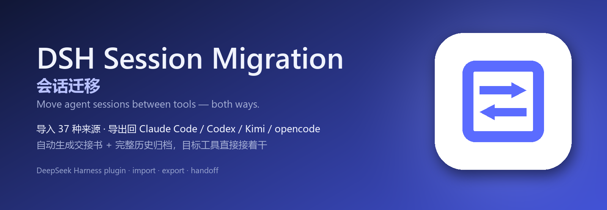

<div align="center">



# DSH Session Migration

**基于 DeepSeek Harness 构建的会话迁移插件：把其他 Agent 的聊天历史一键导入，接着在 DeepSeek Harness 里继续对话；也能把任意 DSH 会话导出回 Claude Code、Codex、Kimi、opencode，并附上一份交接书与完整历史归档，让目标工具直接接着干。**

> **会话双向流动，接着上次继续。**

[](README.md) [](README.zh-CN.md)

[](https://www.npmjs.com/package/dsh-session-migration)
[](https://github.com/95moon/dsh-session-migration)
[](LICENSE)

</div>

> 本仓库 fork 自 [Nwflower/dsh-chat-import](https://github.com/Nwflower/dsh-chat-import)（MIT）。导入管线——37 种来源格式、发现层、互转协议——是原作者的工作，这里保持原样。本 fork 补上另一个方向：会话**导出**面板、七种输出格式、Codex 原生装库，以及让导出会话能直接续聊的「交接书 + 归档」模型。实现细节写在 [docs/TECHNICAL.zh-CN.md](docs/TECHNICAL.zh-CN.md)。


## 支持数据源

<table>
  <tr>
    <td align="center" width="20%"><a href="https://github.com/anthropics/claude-code"><br /><b>Claude Code</b></a></td>
    <td align="center" width="20%"><a href="https://github.com/openai/codex"><br /><b>Codex</b></a></td>
    <td align="center" width="20%"><a href="https://github.com/google-gemini/gemini-cli"><br /><b>Gemini CLI</b></a></td>
    <td align="center" width="20%"><a href="https://github.com/aaif-goose/goose"><br /><b>Goose</b></a></td>
    <td align="center" width="20%"><a href="https://github.com/charmbracelet/crush"><br /><b>Crush</b></a></td>
  </tr>
  <tr>
    <td align="center" width="20%"><a href="https://github.com/qoderAI/qoder-cli"><br /><b>Qoder CLI</b></a></td>
    <td align="center" width="20%"><a href="https://github.com/MoonshotAI/kimi-cli"><br /><b>Kimi CLI</b></a></td>
    <td align="center" width="20%"><a href="https://github.com/MoonshotAI/kimi-code"><br /><b>Kimi Code</b></a></td>
    <td align="center" width="20%"><a href="https://github.com/esengine/DeepSeek-Reasonix"><br /><b>Reasonix</b></a></td>
    <td align="center" width="20%"><a href="https://github.com/anomalyco/opencode"><br /><b>OpenCode</b></a></td>
    <td align="center" width="20%"><a href="https://github.com/AIDotNet/NextCoWork"><br /><b>openCoWork</b></a></td>
  </tr>
  <tr>
    <td align="center" width="20%"><a href="https://github.com/XiaomiMiMo/MiMo-Code"><br /><b>MiMo Code</b></a></td>
    <td align="center" width="20%"><a href="https://z.ai"><br /><b>ZCode</b></a></td>
    <td align="center" width="20%"><a href="https://github.com/xai-org/grok-build"><br /><b>Grok Build</b></a></td>
    <td align="center" width="20%"><a href="https://github.com/openclaw/openclaw"><br /><b>OpenClaw</b></a></td>
    <td align="center" width="20%"><a href="https://github.com/Kilo-Org/kilocode"><br /><b>Kilo Code</b></a></td>
  </tr>
  <tr>
    <td align="center" width="20%"><a href="https://github.com/badlogic/pi-mono"><br /><b>Pi Coding Agent</b></a></td>
    <td align="center" width="20%"><a href="https://github.com/can1357/oh-my-pi"><br /><b>oh-my-pi</b></a></td>
    <td align="center" width="20%"><a href="https://github.com/NousResearch/hermes-agent"><br /><b>Hermes</b></a></td>
    <td align="center" width="20%"><a href="https://cursor.com"><br /><b>Cursor</b></a></td>
    <td align="center" width="20%"><a href="https://github.com/cline/cline"><br /><b>Cline</b></a></td>
  </tr>
  <tr>
    <td align="center" width="20%"><a href="https://github.com/continuedev/continue"><br /><b>Continue</b></a></td>
    <td align="center" width="20%"><a href="https://github.com/zed-industries/zed"><br /><b>Zed</b></a></td>
    <td align="center" width="20%"><a href="https://antigravity.google"><br /><b>Antigravity</b></a></td>
    <td align="center" width="20%"><a href="https://chatgpt.com"><br /><b>ChatGPT</b></a></td>
    <td align="center" width="20%"><a href="https://github.com/gabotechs/workbuddy"><br /><b>WorkBuddy</b></a></td>
  </tr>
  <tr>
    <td align="center" width="20%"><a href="https://github.com/QwenLM/qwen-code"><br /><b>Qwen</b></a></td>
    <td align="center" width="20%"><a href="https://github.com/deepseek-ai/deepseek-harness"><br /><b>DSH</b></a></td>
    <td align="center" width="20%"><a href="https://www.teleai.com.cn/product/super-agent"><br /><b>TeleAgent</b></a></td>
    <td align="center" width="20%"><a href="https://www.trae.ai/"><br /><b>Trae Work</b></a></td>
    <td align="center" width="20%"><a href="https://www.doubao.com/download/desktop"><br /><b>豆包</b></a></td>
    <td align="center" width="20%"><a href="https://github.com/mistralai/mistral-vibe"><br /><b>Mistral Vibe</b></a></td>
    <td align="center" width="20%"><a href="https://codearts.huaweicloud.com/"><br /><b>CodeArts Desktop</b></a></td>
    <td align="center" width="20%"><a href="https://copilot.tencent.com/"><br /><b>CodeBuddy Code</b></a></td>
  </tr>
  <tr>
    <td align="center" width="20%"><a href="#使用"><br /><b>本地 JSONL</b></a></td>
    <td align="center" width="20%"><a href="https://github.com/microsoft/vscode"><br /><b>Copilot VS Code</b></a></td>
    <td align="center" width="20%"><a href="https://github.com/github/copilot-cli"><br /><b>Copilot CLI</b></a></td>
  </tr>
</table>

## 安装

> 插件要求 dsh 0.1.5-rc.1 及以上。已在 0.1.x 与 0.2.x 上验证过，其中 dsh-tools 需满足 `>=0.1.0-rc.6 <0.3.0`。
> 导入默认采用宿主原生的会话格式。DSH 尚无已保存的会话时，首次导入也会自动选择该格式。

1. 用终端安装

```bash
dsh plugin --profile web add dsh-session-migration                    # npm 包
dsh plugin --profile web add github:95moon/dsh-session-migration      # 或者直接从本仓库安装
```

2. 或者从[插件市场](https://github.com/dsh-market/dsh-market)安装

## 使用

1. 通过 GUI 导入会话

  点左侧栏底部的「导入会话」按钮打开导入窗口（用 DSH Claude Style 主题时，这个按钮收在左下角的账号菜单里），选好要导入的会话，一键导入。

  会话行自带工具：**双击**行打开只读预览（跑的是导入的 dry-run，插件注入的消息不出现，工具调用折成一行）；搜索框可切到「**搜内容**」按正文检索；可以把行**隐藏**（可撤销）；可以把单会话来源的文件移进回收站；也可以把行**拖到左侧栏的工作区**上，导入到那个工作区并把时间轴平移到「现在」，让它排在最上面。规则细节见 [docs/USAGE.zh-CN.md](docs/USAGE.zh-CN.md)。

  手上是别的工具导出的文件（网页版导出、自己写的脚本、列表里没有的工具）时，用同一个窗口顶部的「**从文件导入**」：填本机路径后回车，或者点「**选择…**」挑文件。路径是目录时会先问你要不要搜索子文件夹。预览确认之后再导入。识别不出格式时，会逐个列出候选解析器的失败原因，并给出把该格式转换过来的 Skill 指引。

  <table>
    <tr>
      <td align="center" width="50%"></td>
      <td align="center" width="50%"></td>
    </tr>
  </table>

  > 截图界面用的是作者另一个主题插件 [DSH Claude Style](https://github.com/Nwflower/dsh-claude-style) 的 DeepSeek 配色。它在 DSH 里复刻了 Claude Code Desktop 的视觉与交互，提供 Claude、DeepSeek 两套配色；看惯了默认主题的话可以试试。截图里的工作区与会话都是示例数据。

2. 让 Agent 调用工具导入

```
# 参考调用格式
import_chat({ format: "claude", path: "~/.claude/projects" })
import_chat({ format: "chatgpt", path: "~/Downloads/chatgpt-export/conversations.json" })
import_chat({ format: "local-jsonl", path: "D:\downloads\session.jsonl" })
```

Cursor 的工作区分组与导入优先按对话 id 查询本机 Cursor 工作区登记册，只采用现存目录。导入始终重新读取，发现缓存成功结果并在 DB/WAL 变化时失效；畸形 JSON 与文件系统读取失败会在诊断告警中计数。没有可用登记时，仍回退转录所在项目目录名的解码。

3. 把会话导出回别的工具

  点开左侧栏的「**会话迁移**」，切到「**导出**」页，勾选要导出的会话，选格式（可选）填输出目录，然后运行。每行会回报写出的文件（带「**复制路径**」按钮），以及同时生成的交接归档摘要。不开 GUI 也能做：在输入框用 `/export [格式] [会话 id] [--out <路径>]`，或者直接调 `export_chat` 工具。

## 导出

任意 DSH 会话都能写回目标工具打得开的格式；对几个 Agent CLI 而言，写出的还是可以直接接着聊的那一份。

| 格式 | 落点 | 说明 |
| --- | --- | --- |
| `claude` | `~/.claude/projects/<slug>/<uuid>.jsonl` | 用 `claude --resume <uuid>` 续聊 |
| `codex` | `~/.dsh/exports/<session>.rollout.jsonl` | Codex rollout 文件：可读的历史 |
| `codex-native` | Codex 库 + `~/.codex/sessions/...` | 注册一条真的 Codex 线程（SQLite 行 + rollout），Codex 桌面端打开即可见 |
| `kimi` | `~/.dsh/exports/<session>.wire.jsonl` | Kimi CLI 的 wire 格式 |
| `opencode` | `~/.dsh/exports/<session>.opencode.json` | 供 `opencode import` 使用 |
| `bundle` | `~/.dsh/exports/<session>.dshbundle.json` | 便携 DSH bundle，双 SHA-256，可用 `restore_bundle` 还原 |
| `markdown` | `~/.dsh/exports/<session>.md` | 每个会话一份可读文件（覆盖写） |

有两处细节决定导出是「只能看」还是「能接着聊」：

- **工具名会归一化。** 凡是 `[A-Za-z0-9_-]` 之外的字符一律换成 `_`（连续折叠、首尾去掉、最长 64 字符），于是某一个畸形工具名不会再让目标端拒绝整段历史。真实会话里出现过名为 `acp tokens=` 的调用，Codex 当时对整份载荷回的就是 `Invalid 'response.create' payload: Invalid 'input[287].name': string does not match pattern`。
- **工具输出会钳制**到每条 4000 字符（头 60%、尾 40%，中间放显式标记），免得一条失控输出把窗口吃掉。

## 交接书与归档

一次导出同时给出两样东西：一份小到能塞进目标窗口的副本，和一份一点都不小的归档。

**交接书，作为第一条消息注入。** 它在导出时按会话自己的轮次现算——不是要求谁提前写好 handoff.md，也不调用大模型，所以离线可用、零成本。八段固定顺序：项目目标、已完成工作、技术决策、修改文件、测试与验证、未解决问题、下一步任务、历史索引。实测一个 8 轮、175 次工具调用的会话能产出约 8 KB。

**最近几轮，原样保留。** 最后 1~3 轮连工具流量一起带走，接手的人能看到刚才试过什么；更早的轮次保留对话本身（提问与回复正文），丢掉工具参数与输出——体积大头正在那里。

**其余全部进无损归档**，落在 `<项目根>/.dsh/session-handoff/<会话 id>/`：

```
.dsh/session-handoff/<session-id>/
  handoff.md          注入迁移副本的那份交接书
  index.md            目录：轮次、时间、提问、工具数、归档文件
  original.jsonl      全部原始事件，一行一条 JSON，不截断
  turns/NNN.md        每轮一个文件：提问、回复、工具调用、工具输出
  tool-outputs/*.txt  较长的工具输出，从轮次文件里拆出来
  assets/*.png        内联图片，还原成真实文件
```

该目录会登记进 `.git/info/exclude`（只作用于本机克隆，不动项目的 `.gitignore`）。

**预算。** 迁移副本瞄准目标窗口的 5% 左右（46000 字符），任何情况下不超过 20%（186000）。够不到软目标时——单独一轮就可能超过整个预算——副本会退到「仍装得进硬上限、且最保守」的那一档，并如实回报 `fitted: false`，而不是为了凑百分比再砍对话。`original.jsonl` 永不钳制。

实测（真实 8 轮、1154 事件会话）：迁移副本从 917 KB（约 25.5 万 token——258400 窗口刚好卡在临界，这正是当初「上下文已满」报错的来由）压到 86 事件 / 56 KB，约占窗口 6.1%，8 轮对话一轮不缺。

## 配置

为了照顾 TUI 用户，插件提供的工具默认会注入上下文。你可以在设置页里把它们设成**不注入**或**只注入一部分**，这样能省下不少 token。

每个工具、每条命令的完整用法见 **[docs/USAGE.zh-CN.md](docs/USAGE.zh-CN.md)**。

第三方插件可以通过可选的 `sessionMigration` Host Service 调用 `scanDiscover()`、`importPath()`、`importAll()` 和 `resumeSummary()`。这四个方法复用与工具、命令相同的发现、导入、批量导入与交接摘要管线；单会话导入的返回值带 `sessionId`。服务不存在时，调用方要自己降级。

## 功能一览

| 能力 | 入口 | 说明 |
| --- | --- | --- |
| 导入 | 侧边栏面板的「导入」页 | 从其他 Agent 导入对话，保留推理过程、工具调用结果和系统提示词（可选） |
| 文件导入 | 面板「从文件导入」/ `/import auto <path>` | 任意本地文件或目录：三级探测（显式格式 > 内容标记 > 逐格式试跑）、预览先行、目录会问要不要搜索子文件夹。识别失败时摊开各解析器的原因，一键复制可直接发给 Agent 的任务模板，并注册 `dsh-session-migration-convert` 转换 skill |
| 撤回导入 | 侧边栏面板的「历史」页 | 查看导入记录，一键删除本插件创建的会话 |
| 导出 | 侧边栏面板的「导出」页；`/export`；`export_chat` | 七种输出格式（Claude Code、Codex 文件、Codex 原生装库、Kimi、opencode、DSH bundle、Markdown）；工具名归一化、工具输出钳制，目标端不会拒收整份载荷 |
| 交接书与归档 | 每次导出自动执行 | 生成八段交接书，原样保留最近几轮，并把未经改动的完整历史写进 `<项目根>/.dsh/session-handoff/<会话 id>/` |
| 忽略 | 自动登记 + `/ignores` 命令 | 归档、删除、删工作区时自动登记源，重扫时跳过；用 `/ignore`、`/unignore` 管理忽略表 |

Codex 的会话标题优先取 `session_index.jsonl` 里保存的标题（`thread_name`），所以 Codex 里改过的名字也能显示。没有索引标题时，才按与导入共用的提取逻辑回退到首条真实提问，并排除注入的页面上下文。标题索引按行流式读取，同一会话取最后一条有效记录。

Codex 的活动时间取日志头尾有界窗口里最新的有效时间戳，并合并所有 rollout 分页的结果。只有日志里完全没有时间时才回退文件修改时间，所以宿主文件服务不提供修改时间也能取到活动时间。被窗口截断的记录里的时间戳可能漏掉。

Claude Code 的 fork 会话（新版桌面端会话菜单与 `--fork-session`）同样会被发现并导入。fork 转录把父会话的记录逐字拷贝在文件开头，自己的记录从 fork 点开始追加。所以判定主转录时看文件的两端：文件名 stem 出现在头部或尾部，就算这个文件自己的会话。会话身份取转录里最后出现的 `sessionId`。以前这类文件被整类当成子代理辅助转录跳过，一条都扫不到。拷贝过来的父会话历史会留在日志里，因为 fork 的上下文本来就有它，于是父会话与 fork 会话会重叠一段历史。

`opencowork` 按 SQLite schema 自动识别旧 openCoWork（`~/.open-cowork/data.db`）与 NextCoWork（`~/.next-cowork/data/nextcowork.db`），保留正文、thinking、工具调用与结果、标题、工作目录和时间；NextCoWork 子代理会话不单独导入。未知或畸形块、无法配对的工具结果分别计入 `unknownEvents` 与 `orphanResults`。需要旁读附件文件的图片引用与原生压缩元数据暂不还原。

Hermes 在 Windows 上默认扫描 `%LOCALAPPDATA%\hermes` 与 `~/.hermes`；`LOCALAPPDATA` 没有设置时，回退到 `~/AppData/Local/hermes`。macOS 与 Linux 默认扫描 `~/.hermes`。

## 文档

| 文档 | 说明 |
| --- | --- |
| [使用详解](docs/USAGE.zh-CN.md) | 每个工具、每条命令的完整参数、示例与边界行为 |
| [互转协议](docs/INTERCHANGE.md) | Interchange v1 协议与 bundle 格式 |
| [转换指南](docs/INTERCHANGE-GUIDE.zh-CN.md) | 给 Agent 的 Skill 指令：把任意转录转成可导入的 interchange v1 文档 |
| [导入指南](docs/IMPORT-GUIDE.zh-CN.md) | 给 Agent 的 Skill 指令：`import_chat` 的来源格式表、参数详解与重导规则 |
| [设置页迁移](docs/SETTINGS-MIGRATION.zh-CN.md) | DSH 0.1.5 → 0.1.7 插件设置页迁移（实测报错、兼容写法） |
| [技术说明](docs/TECHNICAL.zh-CN.md) | 导出侧、交接书模型、完整归档与 Codex 原生装库是怎么实现的 |
| [更新日志](CHANGELOG.md) | 版本历史（英文） |
| [路线图](docs/ROADMAP.md) | 未完成、计划与明确不做的事项 |
| [贡献指南](docs/CONTRIBUTING.md) | 开发环境、提交规范、安全与隐私 |

## 友链

> 只需要迁移**配置**（技能、hooks、全局设置等）、不需要会话历史的话，推荐用 [dsh-movein](https://github.com/sjh9714/dsh-movein)。

## Star History

[](https://www.star-history.com/?type=date&repos=95moon%2Fdsh-session-migration)
